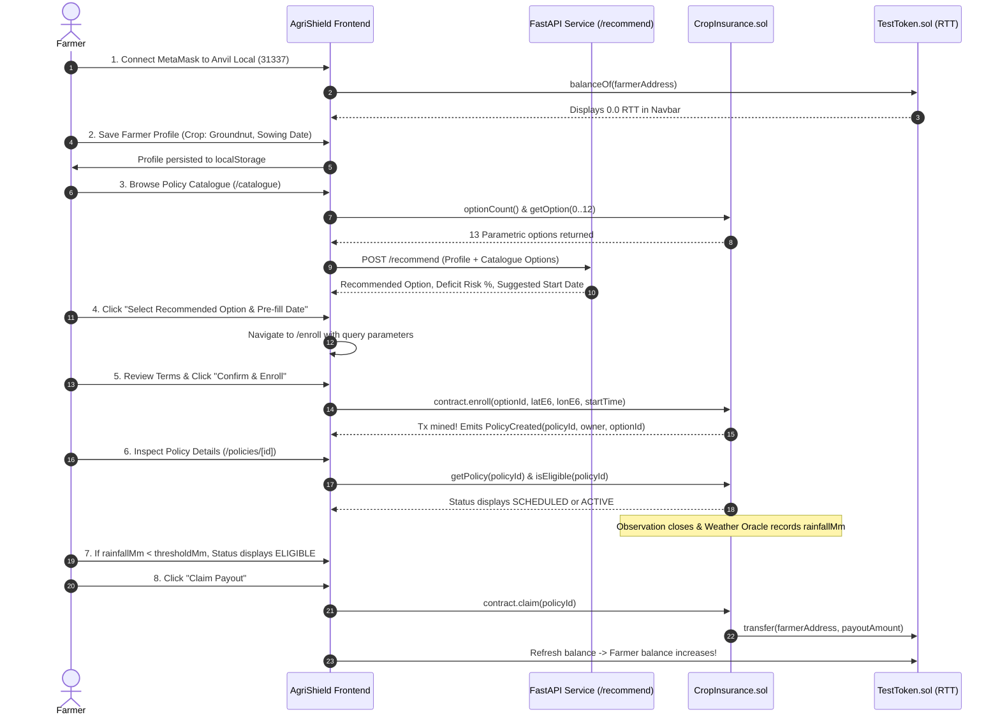

# AgriShield — Smart Rainfall-Based Crop Protection

[](https://nextjs.org/)
[](https://react.dev/)
[](https://www.typescriptlang.org/)
[](https://soliditylang.org/)
[](https://getfoundry.sh/)
[](https://fastapi.tiangolo.com/)
[](https://www.python.org/)
[](https://scikit-learn.org/)
[](https://tailwindcss.com/)
[](https://docs.ethers.org/v6/)

> **AgriShield** is a decentralized, parametric rainfall-based crop insurance decentralized application (dApp). It shields smallholder agricultural producers against devastating seasonal precipitation deficits and drought by coupling autonomous EVM smart contract settlements with calibrated machine learning agro-climatic risk advisory models.

---

## Table of Contents

1. [Project Overview](#1-project-overview)
2. [Technology Stack](#2-technology-stack)
3. [Project Directory Structure](#3-project-directory-structure)
4. [Prerequisites & Verified Versions](#4-prerequisites--verified-versions)
5. [Cloning the Repository](#5-cloning-the-repository)
6. [Smart Contracts & Blockchain Setup (Anvil)](#6-smart-contracts--blockchain-setup-anvil)
7. [AI Recommendation Backend Setup (FastAPI)](#7-ai-recommendation-backend-setup-fastapi)
8. [Frontend DApp Setup (Next.js)](#8-frontend-dapp-setup-nextjs)
9. [Complete Application Startup Instructions](#9-complete-application-startup-instructions)
10. [End-to-End Farmer Application Workflow](#10-end-to-end-farmer-application-workflow)
11. [Testing & Verification Guide](#11-testing--verification-guide)
12. [Troubleshooting Guide](#12-troubleshooting-guide)
13. [Security, Ethics & Academic Disclaimers](#13-security-ethics--academic-disclaimers)
14. [Implementation Status & Verification Matrix](#14-implementation-status--verification-matrix)
15. [Team Contributions & Branching Workflow](#15-team-contributions--branching-workflow)

---

## 1. Project Overview

### 1.1 Problem Statement
Smallholder agriculture remains acutely vulnerable to climate variability, rainfall deficits, and unpredictable monsoon cycles. Traditional agricultural indemnity insurance faces systemic roadblocks:
- **Lengthy Claim Cycles:** Assessments take weeks to months, requiring field adjusters to physically inspect crop damage.
- **Subjective Loss Adjustment:** Discrepancies between farmer expectations and insurance adjuster loss appraisals cause severe friction.
- **High Administrative Costs:** Overhead drives up premiums, excluding resource-constrained farmers.
- **Moral Hazard & Adverse Selection:** Complex paperwork and verification disputes erode farmer confidence.

### 1.2 Proposed Solution: Parametric Crop Insurance
**AgriShield** replaces subjective post-disaster appraisal with **decentralized parametric insurance**:
- **Objective Weather Triggers:** Policies are defined by quantifiable meteorological indicators (accumulated rainfall in millimeters) over fixed growth stages.
- **Smart Contract Automation:** The Ethereum blockchain automatically locks payout funds in escrow and transfers settlements immediately when verified oracle reports confirm precipitation fell strictly below the contractual trigger.
- **AI-Guided Decision Support:** A calibrated Random Forest machine learning advisory engine processes 24 years of historical ERA5/Open-Meteo climate data (2000–2023) against crop growth calendars, helping farmers select the optimal policy window.

### 1.3 Key Objectives & Core Features
- **Deterministic Smart Contract Authority:** The on-chain contract (`CropInsurance.sol`) is the sole decision-maker for policy enrollment, eligibility verification (`isEligible()`), and claim execution (`claim()`).
- **Strict Separation of AI Advisory:** Machine learning models are strictly advisory and off-chain; they never sign transactions, approve claims, or alter contract terms.
- **Fixed 13-Option Catalogue:** Pre-configured parametric options covering Severe, Moderate, and Mild risk tiers (30, 60, 90, 120 days) plus a 2-hour Demo policy (Option 0) for rapid testnet lifecycle verification.
- **Zero-Value RTT Token Economy:** Policies and payouts use Rainfall Test Tokens (`RTT`), an ERC-20 test token deployed on local EVM nodes with zero financial risk.
- **Transparent Dual-Mode Architecture:** Seamless fallback between live local blockchain execution and an in-browser mock contract adapter for offline evaluation.

---

## 2. Technology Stack

| Layer | Technology | Version | Purpose |
| :--- | :--- | :--- | :--- |
| **Frontend Framework** | [Next.js (App Router)](https://nextjs.org/) | `15.5.28` | React Server Components, client-side routing, and static prerendering |
| **UI Library** | [React](https://react.dev/) | `19.1.0` | Declarative UI state management and hooks |
| **Type Safety** | [TypeScript](https://www.typescriptlang.org/) | `5.x` | Strict end-to-end static typing across all modules |
| **Styling** | [Tailwind CSS](https://tailwindcss.com/) | `v4` | Utility-first responsive design system |
| **Blockchain Client** | [Ethers.js](https://docs.ethers.org/v6/) | `6.13.4` | Direct JSON-RPC and EIP-1193 MetaMask communication (No Wagmi/Viem) |
| **Smart Contracts** | [Solidity](https://soliditylang.org/) | `0.8.24` | EVM parametric policy logic and ERC-20 token implementation |
| **Contract Libraries** | [OpenZeppelin Contracts](https://openzeppelin.com/contracts/) | `v5.0.0` | Standard ERC-20 implementation, access control, and math libraries |
| **Blockchain Tooling** | [Foundry](https://getfoundry.sh/) | `0.3.0+` | `forge` (build/test), `anvil` (local node), and `cast` (CLI interaction) |
| **AI Serving Framework** | [FastAPI](https://fastapi.tiangolo.com/) | `0.115.8` | High-performance asynchronous Python REST API |
| **ASGI Server** | [Uvicorn](https://www.uvicorn.org/) | `0.34.0` | Production ASGI web server |
| **Data Validation** | [Pydantic](https://docs.pydantic.dev/) | `2.10.6` | Strict schema validation for incoming recommendation requests |
| **Machine Learning** | [scikit-learn](https://scikit-learn.org/) | `1.8.0 / 1.9.0` | Calibrated Random Forest model for rainfall deficit probability estimation |
| **Data Processing** | [pandas](https://pandas.pydata.org/), [numpy](https://numpy.org/) | Current | Historical precipitation feature extraction and matrix transformations |
| **Model Serialization** | [joblib](https://joblib.readthedocs.io/) | `1.4.2` | Persistent serialization for trained Random Forest weights |
| **Oracle Workflow** | [Chainlink CRE](https://docs.chain.link/cre) | `v0.1.0` | Consensus Report Execution DON simulator and TypeScript reporting workflow |

---

## 3. Project Directory Structure

```
Rainfall_Crop_Insurance/
├── contracts/                        # Member 1: EVM Smart Contracts (Solidity 0.8.24)
│   ├── CropInsurance.sol             # Core parametric insurance contract (enroll, verify, claim)
│   ├── RainfallReportReceiver.sol    # CRE oracle report consumer with forwarder authorization
│   ├── TestToken.sol                 # RTT ERC-20 payout token contract with mint capability
│   ├── cre/                          # Chainlink Runtime Environment receiver interfaces
│   └── interfaces/                   # ICropInsurance Solidity interface definitions
│
├── script/                           # Member 1: Foundry Deployment & Setup Scripts
│   ├── Deploy.s.sol                  # Automated Anvil deployment & pool funding script
│   └── PolicyCatalogue.sol           # Definition of 13 fixed parametric policy options
│
├── test/                             # Member 1: Smart Contract Unit Tests (Foundry)
│   ├── CropInsurance.t.sol           # 35 test cases covering catalogue, enrollment, and claims
│   └── RainfallReportReceiver.t.sol  # Receiver authorization and envelope decoding tests
│
├── frontend/                         # Member 3: Next.js 15 Web3 DApp
│   ├── app/                          # App Router pages
│   │   ├── layout.tsx                # Root layout with WalletProvider & global navigation
│   │   ├── page.tsx                  # Dashboard: active policies, stats, and action prompts
│   │   ├── catalogue/page.tsx        # Catalogue: AI recommendations & 13 policy options
│   │   ├── enroll/page.tsx           # Enrollment: start date picker, preview, & on-chain enroll
│   │   ├── policies/[id]/page.tsx    # Policy Detail: 11-field struct, oracle report, & claim button
│   │   ├── history/page.tsx          # Transaction History: on-chain event ledger
│   │   ├── profile/page.tsx          # Farmer Profile: latitude, longitude, crop, and sowing date
│   │   └── admin/page.tsx            # Admin Panel: restricted contract pool funding controls
│   ├── components/                   # Modular React UI components
│   │   ├── ai/                       # AiRecommendationPanel component
│   │   ├── catalogue/                # OptionCard, CatalogueTable components
│   │   ├── enrollment/               # StartDatePicker, EnrollReview, TxStatus components
│   │   ├── history/                  # HistoryTable component with event log parsing
│   │   ├── layout/                   # Navbar (wallet button, RTT balance), Footer
│   │   ├── policies/                 # PolicyCard, ClaimButton, RainfallReportCard, ResultCard
│   │   └── wallet/                   # NetworkBanner, WalletButton components
│   ├── lib/                          # Application logic, adapters, & helpers
│   │   ├── contract/                 # abi.ts, contractHelpers.ts, catalogueReader.ts, eventIndexer.ts
│   │   ├── ai/                       # aiClient.ts (FastAPI client)
│   │   ├── wallet/                   # walletContext.tsx (MetaMask connection & RTT balance)
│   │   ├── profile/                  # profileStorage.ts (localStorage keying)
│   │   ├── mock/                     # mockAdapter.ts, mockCatalogue.ts, mockPolicies.ts
│   │   └── utils/                    # constants.ts, dateHelpers.ts, formatters.ts
│   ├── .env.example                  # Template for frontend environment variables
│   ├── package.json                  # Frontend dependencies and npm test script
│   └── tsconfig.json                 # Strict TypeScript configuration
│
├── backend/ai_api/                   # Member 3: FastAPI AI Recommendation Service
│   ├── main.py                       # FastAPI entrypoint (/health, /recommend, CORS, lifecycle)
│   ├── schemas.py                    # Pydantic schemas (RecommendRequest, RecommendResponse, etc.)
│   ├── recommend.py                  # Crop stage vulnerability rules & option evaluation
│   ├── model_loader.py               # Robust scikit-learn model loading & compatibility handler
│   ├── weather_client.py             # Open-Meteo historical weather client with regional fallback
│   ├── requirements.txt              # Python backend dependencies
│   ├── .env.example                  # Template for backend environment variables
│   └── tests/                        # Automated API integration tests (pytest)
│
├── ml/                               # Member 2: Machine Learning Pipeline
│   ├── inference/                    # predict_policy_risk.py (scoring & composite ranking)
│   ├── preprocessing/                # clean_rainfall.py, feature_engineering.py
│   ├── training/                     # train_random_forest.py, train_logistic_regression.py
│   ├── config.py                     # Feature list, file paths, and seed configurations
│   └── FASTAPI_INTEGRATION_HANDOFF.md# Technical specification for backend ML integration
│
├── models/                           # Member 2: Trained Model Artifacts
│   └── random_forest.joblib          # Trained Random Forest classifier (34.8 MB)
│
├── data/                             # Member 2: Reference & Meteorological Data
│   └── reference/                    # Karnataka locations, climatology references, crop calendars
│
├── deployments/                      # Contract Deployment Records
│   └── 31337.json                    # Deployed addresses on local Anvil (CropInsurance, TestToken, etc.)
│
├── docs/                             # Comprehensive Engineering Documentation
│   ├── RUNBOOK.md                    # Operational Runbook with terminal-by-terminal walkthrough
│   ├── ARCHITECTURE.md               # End-to-end architecture & workflow sequence diagrams
│   ├── CONTRACTS.md                  # Detailed Solidity contract reference
│   ├── DEMO_SCRIPT.md                # 10-step live demo presentation script with speaker notes
│   ├── AI_DEVELOPMENT_LOG.md         # Audit log of AI-assisted code generation across stages
│   ├── reference/                    # RPD specification and reference schemas
│   └── screenshots/                  # Screenshot catalog of verified application screens
│
├── foundry.toml                      # Foundry workspace configuration
└── README.md                         # This comprehensive project document
```

---

## 4. Prerequisites & Verified Versions

Ensure the following runtimes and tools are installed before launching the platform:

| Software | Minimum Version | Verified Working Version | Installation Guide |
| :--- | :--- | :--- | :--- |
| **Node.js** | `v20.x` | `v24.11.0` / `v20.18.0` | [nodejs.org](https://nodejs.org/) |
| **npm** | `v10.x` | `v10.9.0` | Included with Node.js |
| **Python** | `v3.10+` | `v3.13.0` | [python.org](https://www.python.org/) |
| **Foundry** | `v0.3.0+` | `forge 0.3.0` | [getfoundry.sh](https://getfoundry.sh/) |
| **MetaMask** | Browser Extension | Latest | [metamask.io](https://metamask.io/) |
| **Git** | `v2.40+` | `v2.47.1` | [git-scm.com](https://git-scm.com/) |

---

## 5. Cloning the Repository

Clone the project repository and check out the integration branch:

```bash
# Clone the repository
git clone https://github.com/anu-082006/rainfall-crop-insurance.git

# Enter the project directory
cd rainfall-crop-insurance

# Checkout the AgriShield integration branch
git checkout agri-shield-integration
```

---

## 6. Smart Contracts & Blockchain Setup (Anvil)

### 6.1 Install Foundry (If Not Already Installed)
- **Linux / macOS / WSL:**
  ```bash
  curl -L https://foundry.paradigm.xyz | bash
  foundryup
  ```
- **Windows (PowerShell):**
  Follow the instructions at [Foundry Windows Installation](https://book.getfoundry.sh/getting-started/installation).

Verify Foundry installation:
```bash
forge --version
anvil --version
cast --version
```

### 6.2 Start the Local Anvil Blockchain
Launch Anvil with Chain ID `31337` on port `8545`:
```bash
anvil --chain-id 31337 --port 8545
```
Anvil starts and exposes 10 pre-funded test accounts with private keys.
*Default Test Account 0:* `0xf39Fd6e51aad88F6F4ce6aB8827279cffFb92266`

### 6.3 Deploy the Smart Contracts
Open a separate terminal window from the repository root:
```bash
# Compile contracts
forge build

# Execute the deployment script against local Anvil
forge script script/Deploy.s.sol \
  --rpc-url http://127.0.0.1:8545 \
  --broadcast
```

### 6.4 Verified Deployed Contract Addresses
The script generates `deployments/31337.json` with the following addresses:

| Contract | Address | Purpose |
| :--- | :--- | :--- |
| **`CropInsurance`** | `0x9fE46736679d2D9a65F0992F2272dE9f3c7fa6e0` | Main parametric insurance policy manager |
| **`TestToken` (`RTT`)** | `0xe7f1725E7734CE288F8367e1Bb143E90bb3F0512` | ERC-20 test payout token (funded with 1,000,000 RTT) |
| **`RainfallReportReceiver`** | `0xCf7Ed3AccA5a467e9e704C703E8D87F634fB0Fc9` | Authorized consumer for oracle rainfall reports |
| **`Forwarder`** | `0x5FbDB2315678afecb367f032d93F642f64180aa3` | Authorized Keystone forwarder for DON reports |

### 6.5 Configure MetaMask for Local Anvil
1. Open the MetaMask browser extension.
2. Click the network dropdown (top-left) → **Add Network** → **Add a network manually**.
3. Enter the following details:
   - **Network Name:** `Anvil Local`
   - **New RPC URL:** `http://127.0.0.1:8545`
   - **Chain ID:** `31337`
   - **Currency Symbol:** `ETH`
4. Click **Save** and switch to `Anvil Local`.
5. Import Anvil Test Account 0:
   - In MetaMask, click Account Profile → **Add account or hardware wallet** → **Import account**.
   - Paste the Private Key for Account 0:
     `0xac0974bec39a17e36ba4a6b4d238ff944bacb478cbed5efcae784d7bf4f2ff80`
   - Confirm. Account balance will display `10000 ETH`.

---

## 7. AI Recommendation Backend Setup (FastAPI)

### 7.1 Create and Activate a Python Virtual Environment
Navigate to `backend/ai_api/`:
```bash
cd backend/ai_api

# Create a virtual environment named .venv
python -m venv .venv
```

Activate the environment:
- **Windows (PowerShell):**
  ```powershell
  .venv\Scripts\Activate.ps1
  ```
- **Windows (Command Prompt):**
  ```cmd
  .venv\Scripts\activate.bat
  ```
- **Linux / macOS / WSL:**
  ```bash
  source .venv/bin/activate
  ```

### 7.2 Install Backend Dependencies
```bash
python -m pip install --upgrade pip
python -m pip install -r requirements.txt
```

### 7.3 Model File Verification
Ensure the trained Random Forest model is present at `models/random_forest.joblib` (34.8 MB).
If the model file is missing, download it from GitHub releases:
```bash
# Optional manual download if not cloned:
curl -L -o ../../models/random_forest.joblib \
  https://github.com/anu-082006/rainfall-crop-insurance/releases/download/v0.1.0-ml-models/random_forest.joblib
```

### 7.4 Start the FastAPI ASGI Server
```bash
python -m uvicorn main:app --host 127.0.0.1 --port 8000 --reload
```

### 7.5 Verify Backend Health
- **API Health Endpoint:**
  ```bash
  curl http://127.0.0.1:8000/health
  ```
  Expected output:
  ```json
  {
    "status": "healthy",
    "model_loaded": true,
    "crop_table_loaded": true,
    "recommendation_rule_loaded": true,
    "model_name": "random_forest",
    "model_version": "1.0-production",
    "mode": "production"
  }
  ```
- **Interactive Swagger Documentation:**
  Open [http://127.0.0.1:8000/docs](http://127.0.0.1:8000/docs) in your browser.

---

## 8. Frontend DApp Setup (Next.js)

### 8.1 Install Frontend Node Packages
Open a separate terminal window and navigate to `frontend/`:
```bash
cd frontend
npm install
```

### 8.2 Configure `frontend/.env.local`
Create or update `frontend/.env.local`:
```env
# ── Local Anvil Network Configuration ──
NEXT_PUBLIC_CHAIN_ID=31337
NEXT_PUBLIC_RPC_URL=http://127.0.0.1:8545
NEXT_PUBLIC_CHAIN_NAME="Anvil Local"

# ── Deployed Contract Addresses ──
NEXT_PUBLIC_CONTRACT_ADDRESS=0x9fE46736679d2D9a65F0992F2272dE9f3c7fa6e0
NEXT_PUBLIC_TOKEN_ADDRESS=0xe7f1725E7734CE288F8367e1Bb143E90bb3F0512
NEXT_PUBLIC_EXPLORER_URL=

# ── Integration Flags ──
# Set to 'false' to use the real deployed smart contracts on Anvil
# Set to 'true' to use the browser-persistent mock contract adapter
NEXT_PUBLIC_MOCK_MODE=false

# ── AI Recommendation Service ──
NEXT_PUBLIC_AI_API_URL=http://localhost:8000

# ── Optional Admin Address ──
NEXT_PUBLIC_ADMIN_ADDRESS=
```

### 8.3 Environment Variables Reference Table

| Variable | Required | Default Value | Description |
| :--- | :---: | :--- | :--- |
| `NEXT_PUBLIC_CHAIN_ID` | **Yes** | `31337` | EVM Chain ID of target network (`31337` for local Anvil) |
| `NEXT_PUBLIC_RPC_URL` | **Yes** | `http://127.0.0.1:8545` | JSON-RPC provider for read-only contract calls & event queries |
| `NEXT_PUBLIC_CHAIN_NAME` | No | `"Anvil Local"` | Human-readable network badge displayed in navbar |
| `NEXT_PUBLIC_CONTRACT_ADDRESS` | **Yes** | `0x9fE4...` | Deployed address of `CropInsurance.sol` |
| `NEXT_PUBLIC_TOKEN_ADDRESS` | **Yes** | `0xe7f1...` | Deployed address of `TestToken.sol` (`RTT`) |
| `NEXT_PUBLIC_MOCK_MODE` | **Yes** | `false` | `false` for live contracts; `true` for in-browser mock adapter |
| `NEXT_PUBLIC_AI_API_URL` | **Yes** | `http://localhost:8000` | Base URL for FastAPI recommendation service |
| `NEXT_PUBLIC_ADMIN_ADDRESS` | No | `""` | Restricts access to the `/admin` funding management view |

### 8.4 Start the Next.js Frontend Development Server
```bash
npm run dev
```
Open [http://localhost:3000](http://localhost:3000) in your web browser.

---

## 9. Complete Application Startup Instructions

To run the complete integrated AgriShield platform, keep **3 terminal sessions** open:

```
┌────────────────────────────────────────────────────────────────────────┐
│ TERMINAL 1: Local Anvil Blockchain Node                               │
├────────────────────────────────────────────────────────────────────────┤
│ anvil --chain-id 31337 --port 8545                                     │
└────────────────────────────────────────────────────────────────────────┘

┌────────────────────────────────────────────────────────────────────────┐
│ TERMINAL 2: FastAPI AI Recommendation Service                          │
├────────────────────────────────────────────────────────────────────────┤
│ cd backend/ai_api                                                      │
│ .venv\Scripts\Activate.ps1    # On Linux/macOS: source .venv/bin/activate│
│ python -m uvicorn main:app --host 127.0.0.1 --port 8000 --reload       │
└────────────────────────────────────────────────────────────────────────┘

┌────────────────────────────────────────────────────────────────────────┐
│ TERMINAL 3: Next.js Web3 Frontend                                      │
├────────────────────────────────────────────────────────────────────────┤
│ cd frontend                                                            │
│ npm run dev                                                            │
└────────────────────────────────────────────────────────────────────────┘
```

---

## 10. End-to-End Farmer Application Workflow

Follow this 8-step sequence to demonstrate the complete AgriShield platform:



### Detailed Screen-by-Screen Flow:
1. **Wallet Connection (`/`):** Connect MetaMask. Truncated address and `Anvil Local` network badge appear in top navbar.
2. **Farmer Profile (`/profile`):** Enter Farm Latitude (`16.31`), Longitude (`80.44`), Crop (`Groundnut`), and Sowing Date (`2026-06-15`). Saved per wallet address in browser storage.
3. **AI Policy Recommendation (`/catalogue`):** Queries FastAPI `/recommend`. Evaluates deficit risks for crop growth stages. Recommends the optimal option with full rationale. Option 0 (Demo) is marked non-applicable for seasonal agriculture.
4. **Catalogue Review (`/catalogue`):** Displays all 13 on-chain options with fixed terms: Trigger (mm), Duration (days/hours), Payout (RTT), and Risk Tier.
5. **Review & Enroll (`/enroll`):** Pre-fills AI-suggested date, enforcing whole-day UTC alignment (Options 1–12) or full-hour alignment (Option 0). Displays calculated end-time preview. Submits on-chain `contract.enroll()`.
6. **Policy Details (`/policies/[id]`):** Fetches the 11-field Solidity struct. Displays dynamic policy status badge (`SCHEDULED`, `ACTIVE`, `COVERAGE_ENDED`, `ELIGIBLE`, `NOT_ELIGIBLE`, or `CLAIMED`).
7. **Settlement & Claim (`/policies/[id]`):** When verified rainfall is strictly below trigger threshold, the green **Claim Payout** button activates. Clicking it executes `contract.claim()`, transferring RTT tokens to the farmer.
8. **Transaction Ledger (`/history`):** Real-time audit log of all on-chain events (`PolicyCreated`, `RainfallReportAccepted`, `ClaimPaid`) filtered to the connected wallet.

---

## 11. Testing & Verification Guide

### 11.1 Smart Contract Unit Tests (Foundry)
Execute the complete Solidity test suite:
```bash
forge test
```
*Coverage: 35 passing tests verifying catalogue boundaries, Option 0 constraints, full-hour alignment, observation window timing, and claim payouts.*

### 11.2 Frontend Unit & Integration Tests (Node Test Runner)
Run all 45 automated frontend unit tests:
```bash
cd frontend
npm test
```
*Test Suites Covered:*
- `contractLayer.test.ts`: Policy status derivation rules (RPD Section 8), custom error mapping, and catalogue integrity.
- `eventIndexer.test.ts`: Transaction history indexing, event schema validation, and chronological ordering.
- `profileStorage.test.ts`: Geographic coordinate validation, supported crop checks, and wallet-isolated storage.
- `dateHelpers.test.ts`: UTC midnight alignment, full-hour checks, and computed coverage end-time previews.
- `aiClient.test.ts`: Schema candidate mapping and resilient offline fallback handling.

### 11.3 TypeScript Compilation Check
Verify static typing across the entire frontend application:
```bash
cd frontend
node node_modules/typescript/bin/tsc -p . --noEmit
```
*Expected output: 0 errors.*

### 11.4 Backend AI Integration Tests (pytest)
Execute the backend Python test suite:
```bash
cd backend/ai_api
python -m pytest tests/ -v
```
*Coverage: 9 passing tests validating `/health`, `/recommend`, coordinate limits, Option 0 exclusion, and fallback mechanisms.*

---

## 12. Troubleshooting Guide

### 1. Port Conflicts (Port 8545, 8000, or 3000 In Use)
- **Symptom:** `EADDRINUSE` or `bind: address already in use`.
- **Solution (Windows PowerShell):**
  ```powershell
  # Check which process is using the port (e.g., 8545)
  Get-NetTCPConnection -LocalPort 8545 | Select-Object OwningProcess
  # Stop the process if necessary
  Stop-Process -Id <PID> -Force
  ```

### 2. MetaMask Displays "Wrong Network"
- **Symptom:** Red network banner warns "Wrong network detected. Please switch your wallet to Anvil Local".
- **Solution:** Click the banner or MetaMask network dropdown and switch to `Anvil Local` (Chain ID `31337`). Verify that the RPC URL is `http://127.0.0.1:8545`.

### 3. Smart Contract Calls Fail or Revert
- **`StartNotInFuture` / `StartNotOnFullHour`:** Start time must be at least 1 second in the future and cleanly divisible by `3600` (Option 0) or `86400` (Options 1–12).
- **`ObservationNotEnded`:** Weather reports cannot be submitted until the observation window has elapsed (`currentTime >= endTime`).
- **`NotEligible`:** Claims can only be executed if verified rainfall is strictly below the trigger threshold (`rainfallMm < thresholdMm`).
- **`InsufficientPayoutBalance`:** The contract payout reserve is empty. Run `Deploy.s.sol` or mint tokens to the contract address.

### 4. AI Recommendation Panel Displays "Service Unavailable"
- **Symptom:** Amber warning banner in AI panel; manual option selection remains available.
- **Solution:** Verify the FastAPI backend is running on `127.0.0.1:8000`. Test with `curl http://127.0.0.1:8000/health`.

### 5. Missing Machine Learning Model File
- **Symptom:** Backend starts in mock fallback mode or reports `random_forest.joblib not found`.
- **Solution:** Download `random_forest.joblib` from GitHub releases and place it under `models/random_forest.joblib`.

### 6. Empty Transaction History (`/history`)
- **Symptom:** History page shows 0 transactions after submitting enrollment.
- **Solution:** Ensure your wallet is connected to `Anvil Local`. Confirm the transaction was mined by checking the terminal where `anvil` is running.

---

## 13. Security, Ethics & Academic Disclaimers

### 13.1 Credential & Secret Protection
- **Never commit `.env.local` or `.env`:** These files are ignored via `.gitignore` to prevent secret leakage.
- **Disposable Anvil Private Keys:** The private keys displayed in documentation are standard local Anvil testing keys. Never use these keys on Ethereum Mainnet or public testnets.

### 13.2 Real Mode vs. Mock Mode
- **Live Real Mode (`NEXT_PUBLIC_MOCK_MODE=false`):** Transactions require MetaMask signature and are broadcast to local Anvil EVM nodes.
- **Zero-Dependency Mock Mode (`NEXT_PUBLIC_MOCK_MODE=true`):** Simulates all 7 contractual policy states entirely in-browser with zero external blockchain or RPC dependencies. Ideal for quick offline grading and presentation.

### 13.3 Academic Prototype Disclaimer
> **IMPORTANT NOTICE:** AgriShield is an academic engineering prototype developed for university evaluation and educational demonstration. The RTT (Rainfall Test Tokens) are simulated ERC-20 tokens with **zero financial value**. No real insurance policies are legally underwritten, no real premiums are collected, and no financial liabilities are assumed.

---

## 14. Implementation Status & Verification Matrix

| Module | Feature | Implementation Status | Verification Method |
| :--- | :--- | :---: | :--- |
| **Smart Contracts** | Parametric Policy Catalogue (13 options) | **Complete** | Verified via `forge test` (35 tests) |
| **Smart Contracts** | Policy Enrollment (`enroll()`) | **Complete** | Verified on Anvil with `Deploy.s.sol` & frontend |
| **Smart Contracts** | Payout Escrow & Claim (`claim()`) | **Complete** | Verified on Anvil with funded 1,000,000 RTT pool |
| **Smart Contracts** | Report Receiver (`RainfallReportReceiver`) | **Complete** | Verified with mock forwarder unit tests |
| **Machine Learning** | 24-Year Rainfall Dataset Pipeline | **Complete** | Verified on Karnataka ERA5 data (2000–2023) |
| **Machine Learning** | Calibrated Random Forest Model | **Complete** | Verified with 8 ML tests; 34.8 MB joblib serialized |
| **AI Backend** | FastAPI Recommendation API (`/recommend`) | **Complete** | Verified via `pytest` (9 tests) & live curl check |
| **AI Backend** | Production ML Model Serving | **Complete** | Verified loading `random_forest` (v`1.0-production`) |
| **Frontend** | MetaMask EIP-1193 Wallet Connection | **Complete** | Verified with Anvil Local auto-detection |
| **Frontend** | Farmer Profile Management | **Complete** | Verified with localStorage wallet-specific keying |
| **Frontend** | Live Catalogue & AI Recommendation Display | **Complete** | Verified reading on-chain terms from Anvil |
| **Frontend** | On-Chain Policy Enrollment Submission | **Complete** | Verified with Ethers v6 signer transaction submission |
| **Frontend** | Dynamic Policy Status Derivation | **Complete** | Verified across all 7 RPD Section 8 rules |
| **Frontend** | On-Chain Event History Ledger | **Complete** | Verified with Ethers `queryFilter()` indexing |
| **Frontend** | Unit & Contract Layer Test Suite | **Complete** | Verified with 45 passing tests across 11 suites |
| **Oracle Pipeline** | Local CRE Simulator Reporting | **Tested Locally** | Verified via `@chainlink/cre-sdk` local broadcast |
| **Oracle Pipeline** | Decentralized Mainnet DON Execution | *Pending Deployment* | Awaiting mainnet Chainlink CRE production DON |

---

## 15. Team Contributions & Branching Workflow

### 15.1 Individual Responsibilities
- **Member 1 (Smart Contracts & Blockchain Architecture):**
  Author of `CropInsurance.sol`, `TestToken.sol`, `RainfallReportReceiver.sol`, `Deploy.s.sol`, and Foundry unit test suites (`CropInsurance.t.sol`).
- **Member 2 (Machine Learning & Oracle Pipeline):**
  Author of dataset pipelines, feature engineering, scikit-learn Random Forest model training, Open-Meteo data integration, and Chainlink CRE workflow simulator (`cre-workflow/`).
- **Member 3 (Frontend DApp, AI Serving Layer, Integration & Documentation):**
  Author of Next.js 15 dApp, MetaMask wallet integration, FastAPI serving layer (`backend/ai_api/`), contract integration layer, event indexer, end-to-end tests, operational runbooks, and master documentation.

### 15.2 Git Branching Workflow
To maintain clean separation of concerns and protect existing contributions:
- `main`: Protected production-ready branch containing baseline contracts and configuration.
- `feature/policy-catalogue`: Member 1 contract iteration branch.
- `cre-part-one`: Member 2 machine learning and Chainlink CRE workflow branch.
- `agri-shield-integration`: **Current submission branch** uniting Member 1's contracts, Member 2's ML model, and Member 3's frontend, backend, and documentation into a fully verified system.
