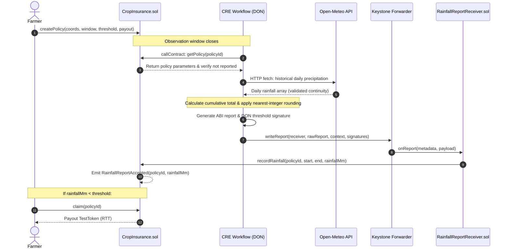

# Rainfall-Based Parametric Crop Insurance DApp

A decentralized parametric crop insurance protocol powered by **Chainlink Runtime Environment (CRE)** and **Solidity** smart contracts. The protocol automates the entire lifecycle of crop insurance policies: reading on-chain policy conditions, querying verified historical rainfall data via Decentralized Oracle Networks (DONs), and executing trustless settlement through authorized forwarders.

> **Branch:** `cre-part-one`  
> Implements and verifies the full end-to-end CRE TypeScript workflow, mock Keystone forwarder unwrap architecture, on-chain report recording on local Anvil, and comprehensive failure case testing.

---

## Architecture & Data Flow



---

## Smart Contracts

| Contract | Location | Description |
|---|---|---|
| `CropInsurance` | [`contracts/CropInsurance.sol`](contracts/CropInsurance.sol) | Manages policy creation, observation dates, final rainfall reports, payout claims, and token reserves. |
| `RainfallReportReceiver` | [`contracts/RainfallReportReceiver.sol`](contracts/RainfallReportReceiver.sol) | CRE consumer contract inheriting `ReceiverTemplate`. Enforces forwarder authorization and version validation (`REPORT_VERSION = 1`). |
| `MockKeystoneForwarder` | [`contracts/cre/MockKeystoneForwarder.sol`](contracts/cre/MockKeystoneForwarder.sol) | Local simulator forwarder. Unwraps 109-byte Keystone envelopes and routes payloads and metadata into `onReport()`. |
| `TestToken` | [`contracts/TestToken.sol`](contracts/TestToken.sol) | Mock ERC-20 (`RTT`) token used for paying out insurance claims in local testing. |
| `ReceiverTemplate` | [`contracts/cre/ReceiverTemplate.sol`](contracts/cre/ReceiverTemplate.sol) | Official Chainlink CRE abstract base contract with forwarder check and workflow identity filters. |

---

## CRE Workflow Architecture (`cre-workflow/rainfall-workflow`)

Built with the official `@chainlink/cre-sdk` and compiled to WebAssembly (WASM) via Javy.

* **`src/main.ts`**: Pure WASM entry point exporting parameterless `export async function main()` matching Javy WIT specifications.
* **`src/handler.ts`**: End-to-end orchestration handler triggered by HTTP capability:
  1. Receives policy ID from payload.
  2. Reads policy from `CropInsurance` via EVM capability.
  3. Checks `reported == false` to prevent duplicate submissions.
  4. Queries Open-Meteo historical weather API via HTTP capability.
  5. Validates daily continuity and absence of null/missing records.
  6. Computes cumulative sum and applies documented nearest-integer rounding (`Math.round()`).
  7. ABI-encodes 5-tuple report: `(uint8 version, uint256 policyId, uint64 startTime, uint64 endTime, uint256 rainfallMm)`.
  8. Obtains DON threshold signatures and submits to receiver via `evmClient.writeReport()`.
* **`src/weather.ts`**: Open-Meteo HTTP capability integration using standard `TextDecoder`.
* **`src/rainfall.ts`**: Cumulative calculation and rounding logic.
* **`src/report.ts`**: Viem-based ABI serialization matching `RainfallReportReceiver`.
* **`src/policy.ts`**: Policy parsing, fixed-point E6 coordinate conversion, and window validation.

---

## Prerequisites

* [Foundry](https://getfoundry.sh/) (`anvil`, `forge`, `cast`)
* [Bun](https://bun.sh/) (v1.2+)
* [Chainlink CRE CLI](https://docs.chain.link/cre) (`cre`)

---

## Quickstart & Simulation Guide

### 1. Run Local Anvil Node
In a dedicated terminal:
```bash
anvil --chain-id 31337 --port 8545
```

### 2. Deploy Smart Contracts
```bash
forge script script/Deploy.s.sol --rpc-url http://127.0.0.1:8545 --broadcast
```
*Note: Contract addresses are recorded in `deployments/31337.json`.*

### 3. Create a Test Policy
Create a sample policy (Location: Bangalore, 1–7 Oct 2026, 50mm threshold, 100 RTT payout):
```bash
cast send <CROP_INSURANCE_ADDRESS> \
  "createPolicy(int32,int32,uint64,uint64,uint256,uint256)" \
  12971000 77594000 1790812800 1791417600 50 100000000000000000000 \
  --private-key 0xac0974bec39a17e36ba4a6b4d238ff944bacb478cbed5efcae784d7bf4f2ff80 \
  --rpc-url http://127.0.0.1:8545
```

Warp past the observation period so the contract permits reporting:
```bash
cast rpc evm_increaseTime 1000000 --rpc-url http://127.0.0.1:8545
cast rpc evm_mine --rpc-url http://127.0.0.1:8545
```

### 4. Run CRE Workflow Simulation (Dry-Run)
Navigate to `cre-workflow` and simulate:
```bash
cd cre-workflow
cre workflow simulate rainfall-workflow --target local-settings --http-payload ./payload.json
```

### 5. Run CRE Workflow with On-Chain Broadcast
Submit the verified report directly to the blockchain:
```bash
cre workflow simulate rainfall-workflow --target local-settings --broadcast --http-payload ./payload.json
```

### 6. Verify On-Chain State
Confirm that `reported` is now `true` and `rainfallMm` has been recorded:
```bash
cast call <CROP_INSURANCE_ADDRESS> \
  "getPolicy(uint256)((address,int32,int32,uint64,uint64,uint256,uint256,bool,uint256,bool))" 1 \
  --rpc-url http://127.0.0.1:8545
```

---

## Test Verification

### Contract Unit Tests (Foundry)
Runs all 26 test cases for policy creation, thresholds, claims, and receiver security:
```bash
forge test
```
*Result: 26 passed, 0 failed.*

### Workflow Unit & Integration Tests (Bun)
Runs all 6 end-to-end TypeScript validation tests:
```bash
cd cre-workflow/rainfall-workflow
bun test
```
*Result: 6 passed, 0 failed.*

### Static Typechecking
```bash
bun run typecheck
```
*Result: 0 errors.*

---

## 13-Case Verification Matrix

| Test Scenario | Expected Result | Status | Verification Method |
|---|---|:---:|---|
| **1. Valid policy** | Policy parameters successfully read | **PASS** | CRE EVM capability read (`src/policy.ts`) |
| **2. Invalid policy ID** | Workflow halts on non-existent policy | **PASS** | Tested `#999` $\rightarrow$ Reverted `PolicyNotFound(999)` |
| **3. Already reported policy** | Workflow halts if report already filed | **PASS** | Step 2 check skips duplicate execution |
| **4. Valid Open-Meteo response** | 7 consecutive daily records fetched | **PASS** | CRE HTTP capability (`src/weather.ts`) |
| **5. API unavailable** | Workflow aborts on network error | **PASS** | Handled & verified in `workflow.test.ts` |
| **6. Missing rainfall value** | Rejects null or undefined rain value | **PASS** | Handled & verified in `workflow.test.ts` |
| **7. Missing date** | Rejects gaps in observation series | **PASS** | Handled & verified in `workflow.test.ts` |
| **8. Valid rainfall records** | Cumulative summation accurately calculated | **PASS** | Sum of daily values: `16.80 mm` |
| **9. Decimal rainfall** | Single nearest-integer rounding applied | **PASS** | `16.80 mm` rounded to `17 mm` |
| **10. Wrong report version** | Receiver rejects non-version 1 payloads | **PASS** | Tested in `RainfallReportReceiver.t.sol` |
| **11. Wrong policy ID / dates** | Contract rejects mismatched parameters | **PASS** | Tested in `CropInsurance.t.sol` |
| **12. Valid report submission** | Contract accepts report and records rainfall | **PASS** | Tx broadcast confirmed on Anvil (`reported: true`, `17 mm`) |
| **13. Duplicate report submission** | Rejects subsequent report submissions | **PASS** | Contract reverts with `ReportAlreadyReceived(policyId)` |
