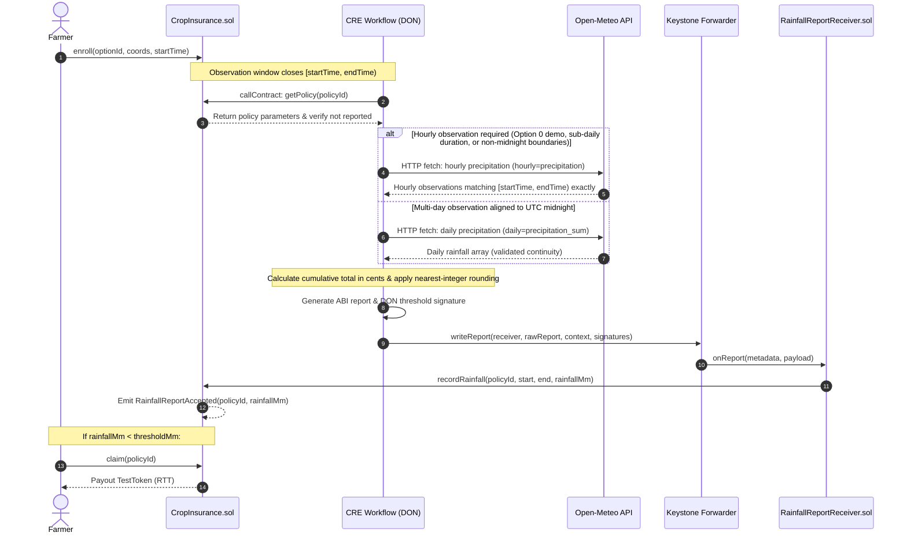

# Rainfall-Based Parametric Crop Insurance DApp

A decentralized parametric crop insurance protocol powered by **Chainlink Runtime Environment (CRE)** and **Solidity** smart contracts. The protocol automates the entire lifecycle of crop insurance policies: reading on-chain policy conditions, querying verified historical rainfall data via Decentralized Oracle Networks (DONs), selecting observation granularity (hourly vs daily), and executing trustless settlement through authorized forwarders.

> **Branch:** `cre-part-one`  
> Implements and verifies the full end-to-end CRE TypeScript workflow, dynamic hourly/daily granularity selection, mock Keystone forwarder unwrap architecture, on-chain report recording on local Anvil, and comprehensive failure case testing.

---

## Architecture & Data Flow



---

## Granularity Selection Logic (Hourly vs. Daily)

The workflow dynamically determines whether to fetch **hourly** (`hourly=precipitation`) or **daily** (`daily=precipitation_sum`) rainfall data from Open-Meteo:

1. **Hourly Granularity is Required When:**
   * Policy is **Option 0** (2-hour Demo policy).
   * Policy observation duration is sub-daily (`duration < 86,400` seconds).
   * Policy `startTime` does not align to UTC midnight (`startTime % 86,400 !== 0`).
   * Policy `endTime` does not align to UTC midnight (`endTime % 86,400 !== 0`).
   * Policy `duration` is not a whole multiple of 24-hour days (`duration % 86,400 !== 0`).
   * *Rationale:* Open-Meteo daily data aggregates calendar days from 00:00:00 to 23:59:59 UTC. For any window not matching calendar-day boundaries, daily aggregation introduces rainfall from outside the policy window. Hourly observation queries all hours and filters strictly to `[startTime, endTime)`.

2. **Daily Granularity is Used When:**
   * Policy spans full UTC calendar days (`duration >= 86,400` and `duration % 86,400 === 0`).
   * `startTime` and `endTime` both align with UTC midnight (`startTime % 86,400 === 0` and `endTime % 86,400 === 0`).
   * Policy is not the Demo option (`optionId !== 0`).

---

## Forwarder Verification & Addressing

The authorized forwarder is verified directly against Chainlink CRE network definitions (`cre workflow supported-chains`):

* **Sepolia CRE Simulation (Mock Forwarder):** `0x15fC6ae953E024d975e77382eEeC56A9101f9F88`  
  During simulation targeting `ethereum-testnet-sepolia`, CRE CLI dispatches transactions to this mock address. `MockKeystoneForwarder` unwraps the 109-byte Keystone envelope header and routes the inner report to `RainfallReportReceiver.onReport()`.
* **Sepolia / Mainnet Live Production (Keystone Forwarder):** `0xF8344CFd5c43616a4366C34E3EEE75af79a74482`  
  Official forwarder contract authorized to verify DON threshold signatures.

---

## Smart Contracts

| Contract | Location | Description |
|---|---|---|
| `CropInsurance` | [`contracts/CropInsurance.sol`](contracts/CropInsurance.sol) | Fixed 13-option catalogue, policy enrollment, observation window checks, final report recording, and claim payouts. |
| `RainfallReportReceiver` | [`contracts/RainfallReportReceiver.sol`](contracts/RainfallReportReceiver.sol) | CRE consumer contract inheriting `ReceiverTemplate`. Enforces forwarder authorization and version validation (`REPORT_VERSION = 1`). |
| `MockKeystoneForwarder` | [`contracts/cre/MockKeystoneForwarder.sol`](contracts/cre/MockKeystoneForwarder.sol) | Local simulator forwarder. Unwraps 109-byte Keystone envelopes and routes payloads and metadata into `onReport()`. |
| `TestToken` | [`contracts/TestToken.sol`](contracts/TestToken.sol) | Mock ERC-20 (`RTT`) token used for paying out insurance claims in local testing. |
| `ReceiverTemplate` | [`contracts/cre/ReceiverTemplate.sol`](contracts/cre/ReceiverTemplate.sol) | Official Chainlink CRE abstract base contract with forwarder check and workflow identity filters. |

---

## CRE Workflow Architecture (`cre-workflow/rainfall-workflow`)

Built with the official `@chainlink/cre-sdk` and compiled to WebAssembly (WASM).

* **`src/main.ts`**: Pure WASM entry point exporting parameterless `export async function main()` matching Javy WIT specifications.
* **`src/handler.ts`**: End-to-end orchestration handler triggered by HTTP capability:
  1. Receives policy ID from payload.
  2. Reads policy from `CropInsurance` via EVM capability (`getPolicy(policyId)`).
  3. Checks `reported == false` to prevent duplicate submissions.
  4. Evaluates `isHourlyGranularityRequired(startTime, endTime, optionId)`.
  5. Queries Open-Meteo historical weather API via HTTP capability with DON BFT consensus.
  6. Validates continuity and strictly rejects null, NaN, negative, or missing records.
  7. Computes cumulative sum in fixed-point cents (0.01 mm) and applies documented nearest-integer rounding once (`Math.round()`).
  8. ABI-encodes 5-tuple report: `(uint8 version, uint256 policyId, uint64 startTime, uint64 endTime, uint256 rainfallMm)`.
  9. Obtains DON threshold signatures and submits to receiver via `evmClient.writeReport()`.
* **`src/weather.ts`**: Open-Meteo HTTP capability integration supporting both daily and hourly endpoints with zero-tolerance validation.
* **`src/rainfall.ts`**: High-precision cumulative calculation and rounding logic.
* **`src/report.ts`**: Viem-based ABI serialization matching `RainfallReportReceiver`.
* **`src/policy.ts`**: Policy parsing, `optionId` and `duration` validation, coordinate conversion, and granularity decision logic.

---

## Prerequisites

* [Foundry](https://getfoundry.sh/) (`anvil`, `forge`, `cast`)
* [Bun](https://bun.sh/) (v1.2+)
* [Chainlink CRE CLI](https://docs.chain.link/cre) (`cre`)

---

## Quickstart & Simulation Guide

### 1. Run Local Anvil Node
```bash
anvil --chain-id 31337 --port 8545
```

### 2. Deploy Smart Contracts
```bash
forge script script/Deploy.s.sol --rpc-url http://127.0.0.1:8545 --broadcast
```

### 3. Enroll in Option 0 (2-Hour Demo Policy)
Enroll in Option 0 starting at the next full hour:
```bash
cast send <CROP_INSURANCE_ADDRESS> \
  "enroll(uint256,int32,int32,uint64)" \
  0 12971000 77594000 <START_TIMESTAMP> \
  --private-key 0xac0974bec39a17e36ba4a6b4d238ff944bacb478cbed5efcae784d7bf4f2ff80 \
  --rpc-url http://127.0.0.1:8545
```

Warp past the observation period (`endTime = startTime + 2 hours`) so reporting is allowed:
```bash
cast rpc evm_setNextBlockTimestamp <AFTER_END_TIMESTAMP> --rpc-url http://127.0.0.1:8545
cast rpc evm_mine --rpc-url http://127.0.0.1:8545
```

### 4. Run CRE Workflow with On-Chain Broadcast
Submit the verified report directly to the blockchain via CRE simulator:
```bash
cd cre-workflow
cre workflow simulate rainfall-workflow --target local-settings --broadcast --http-payload ./payload.json
```

### 5. Verify On-Chain State & Claim
Confirm that `reported` is now `true` and `rainfallMm` has been recorded:
```bash
cast call <CROP_INSURANCE_ADDRESS> \
  "getPolicy(uint256)((address,uint256,int32,int32,uint64,uint64,uint256,uint256,bool,uint256,bool))" 1 \
  --rpc-url http://127.0.0.1:8545
```

If rainfall is strictly below the threshold, claim the payout:
```bash
cast send <CROP_INSURANCE_ADDRESS> "claim(uint256)" 1 \
  --private-key 0xac0974bec39a17e36ba4a6b4d238ff944bacb478cbed5efcae784d7bf4f2ff80 \
  --rpc-url http://127.0.0.1:8545
```

---

## Test Verification

### Contract Unit Tests (Foundry)
Runs all 35 test cases for catalogue options, enrollment terms, claims, receiver security, and forwarder envelope unwrapping:
```bash
forge test
```
*Result: 35 passed, 0 failed.*

### Workflow Unit & Integration Tests (Bun)
Runs all 9 end-to-end TypeScript validation tests:
```bash
cd cre-workflow
bun test
```
*Result: 9 passed, 0 failed.*

### Static Typechecking
```bash
cd cre-workflow
bun run typecheck
```
*Result: 0 errors.*
