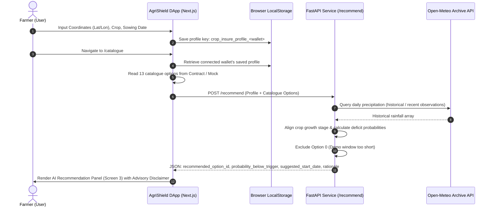
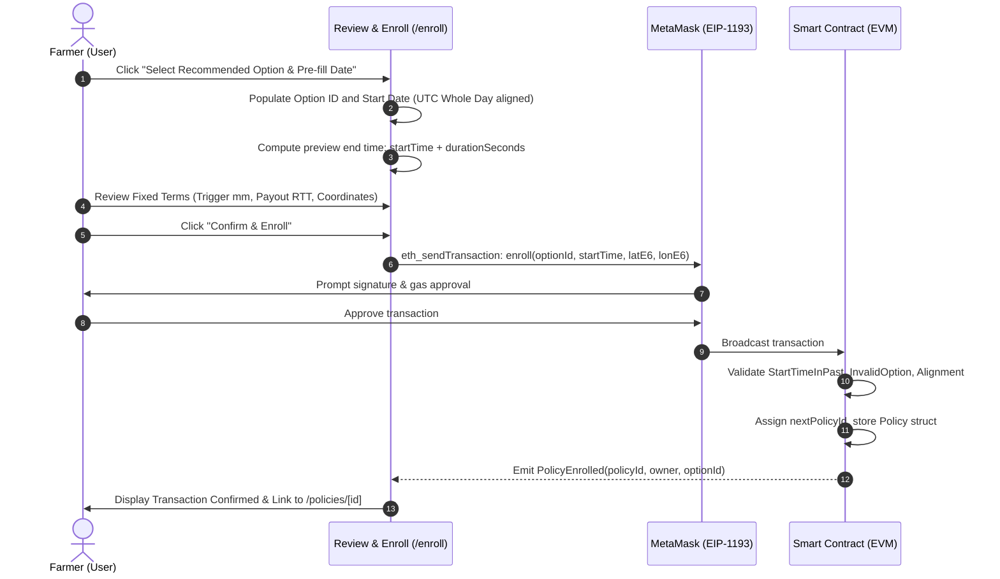
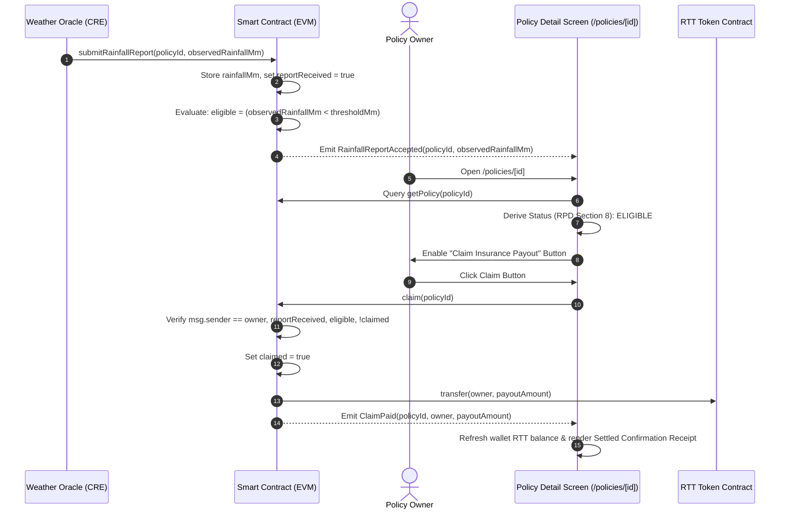
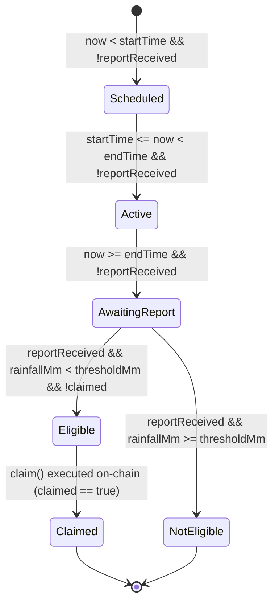

# AgriShield System Architecture (M3-DOC05)

This document provides a technical specification of the **AgriShield** Rainfall-Based Parametric Crop Insurance decentralized platform.

---

## 1. System Overview & Component Hierarchy

AgriShield consists of three decoupled architectural layers:

1. **Frontend Presentation & Web3 Integration Layer (Member 3)**:
   - Next.js 15 (App Router) + React 19 + TypeScript + Tailwind CSS v4.
   - Pure Ethers.js v6 for blockchain interactions (no Wagmi or Viem dependencies).
   - EIP-1193 MetaMask wallet connection and lifecycle event listeners (`accountsChanged`, `chainChanged`).
   - Browser-persistent localStorage keying for farmer profiles (`crop_insure_profile_<wallet>`).
   - Browser mock contract adapter implementing full EVM simulation (Appendix A.3).
2. **Blockchain & Parametric Smart Contract Layer (Member 1)**:
   - EVM Smart Contract (`CropInsurance.sol`) managing 13 fixed parametric options.
   - Standard ERC-20 token (`RainfallTestToken.sol` / RTT) serving as the simulated indemnity payout asset (18 decimals).
   - On-chain event emission: `PolicyEnrolled`, `RainfallReportAccepted`, `ClaimPaid`.
   - Contract custom error specifications (RPD Section 9 & Appendix A.2).
3. **AI Recommendation & Agro-Climatic Serving Layer (Stage 6 / Member 2 & 3)**:
   - Python 3.13 FastAPI serving application exposing `/health` and `/recommend`.
   - Open-Meteo Historical Archive API client with local climatological fallback resilience.
   - Crop vulnerability growth stage matrix across 8 crops (`groundnut`, `maize`, `rice`, `wheat`, `cotton`, `soybean`, `millet`, `sorghum`).
   - Pluggable scikit-learn model loading interface with lazy initialization and MockModelAdapter.

---

## 2. Core Architectural Workflows

### Flow 1: Farmer Profile & AI Recommendation Workflow

---

### Flow 2: Policy Enrollment Lifecycle

---

### Flow 3: Weather Oracle Precipitation Verification & Claim Settlement

---

## 3. Policy Status Derivation State Machine (RPD Section 8)

The frontend derives policy lifecycle states from contract data and current Unix timestamp according to strict precedence rules:

### Precedence Table:
1. **`CLAIMED`**: If `claimed == true` (Highest priority terminal state).
2. **`ELIGIBLE`**: If `reportReceived == true` AND `rainfallMm < thresholdMm`.
3. **`NOT_ELIGIBLE`**: If `reportReceived == true` AND `rainfallMm >= thresholdMm` (Equal counts as not below).
4. **`SCHEDULED`**: If `!reportReceived` AND `now < startTime`.
5. **`AWAITING_REPORT`**: If `!reportReceived` AND `now >= endTime`.
6. **`ACTIVE`**: If `!reportReceived` AND `startTime <= now < endTime`.

---

## 4. Error Handling & Architectural Isolation Guarantees

1. **Smart Contract Custom Errors**:
   All contract reverts (`InvalidOption`, `StartTimeInPast`, `InvalidStartAlignment`, `NotPolicyOwner`, `AlreadyClaimed`, `InsufficientPayoutBalance`) are caught by `errorMapper.ts` and translated into actionable user feedback.
2. **MetaMask Rejection**:
   User signature rejections (EIP-1193 code `4001`) reset transaction state to idle immediately without sticky red error boxes.
3. **Missing Data Protection**:
   Policies awaiting oracle verification **never display 0 mm**; rainfall values are explicitly flagged as *Pending Oracle Report*.
4. **AI Serving Fault Tolerance**:
   If the Python FastAPI backend is offline or network fails, the frontend displays an informational retry banner while keeping catalogue browsing, manual enrollment, and claim settlements 100% operational.
